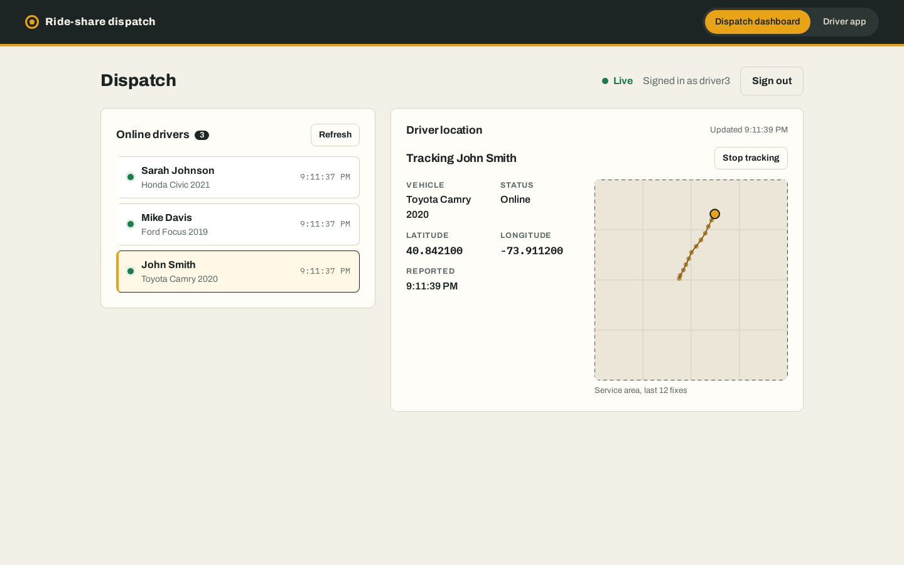
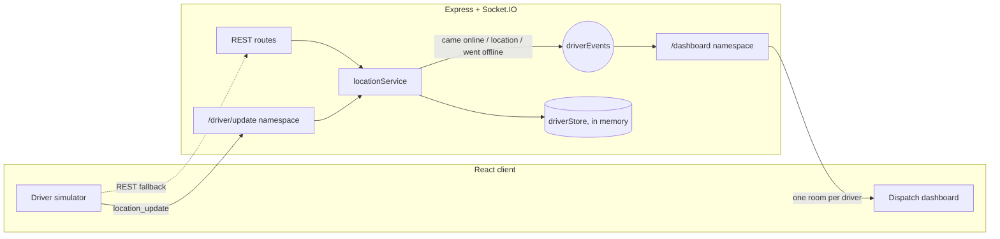
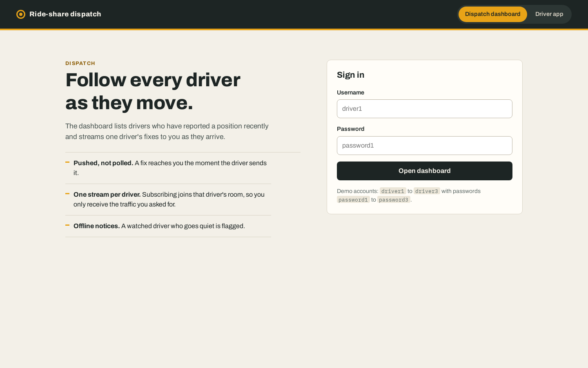
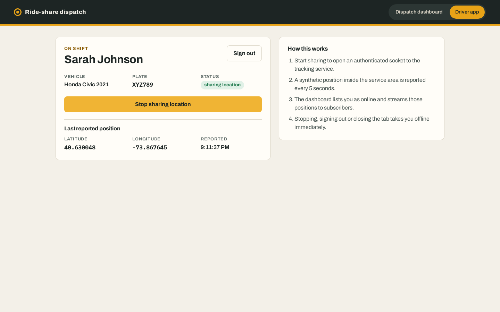
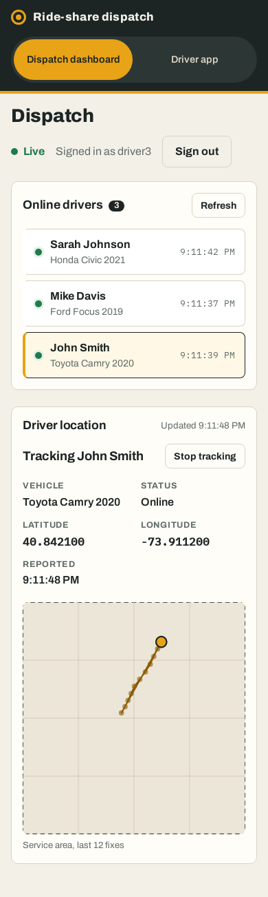
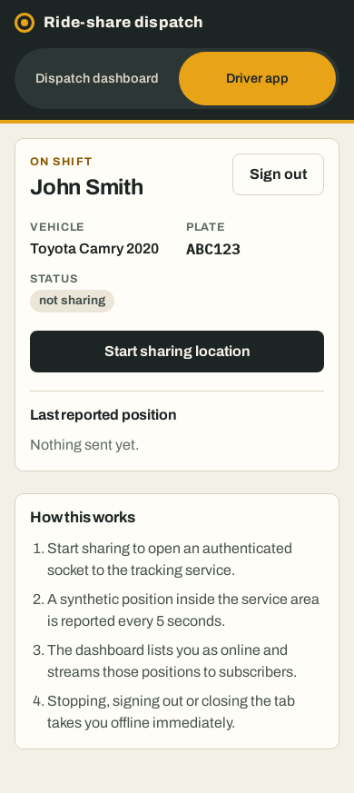

# Ride-share driver tracking

Live driver location tracking for a ride-share fleet. Drivers sign in and report their position over a WebSocket (or REST when the socket is down). A dispatch dashboard lists who is online and follows one driver at a time, receiving each fix the moment it arrives. There are no trips, fares or passengers here, only driver presence and coordinates.

The repo has two parts:

- `src/`: an Express 5 + Socket.IO API with JWT sign-in, server-side token revocation and per-driver broadcast rooms.
- `frontend/`: a React client (Vite) with the dispatch dashboard and a driver simulator that sends synthetic positions.



## Quick start with Docker Compose

Docker with Compose v2 is all you need.

```bash
cp .env.example .env
# Compose refuses to start without a signing key:
sed -i.bak "s/^JWT_SECRET=.*/JWT_SECRET=$(openssl rand -hex 32)/" .env && rm .env.bak
docker compose up --build
```

- Web client: http://localhost:3000
- API and sockets: http://localhost:3001 (`/health` reports status)

Then try it with two browser tabs:

1. In the first tab, choose **Driver app**, sign in as `driver1` / `password1` and press **Start sharing location**. A random position inside the service area is sent every 5 seconds.
2. In the second tab, sign in to the **Dispatch dashboard** with any demo account and pick the driver from the list. Fixes stream in and are drawn on the service-area plot.

Demo accounts are `driver1` to `driver3` with passwords `password1` to `password3` (see `src/utils/credentials.js`). `docker compose down` stops everything. All state is in memory, so a restart starts from an empty fleet.

## Local development

Node 22.12 or newer (`.nvmrc` pins 22).

```bash
cp .env.example .env          # JWT_SECRET may stay empty outside production
npm install
npm run dev                   # API and sockets on :3001, restarts on change

cd frontend
npm install
npm run dev                   # client on :3000
```

The client reads `VITE_API_URL` at build time and defaults to `http://localhost:3001`. Put it in `frontend/.env.local` to point the dev server elsewhere. The API only accepts browser origins listed in `CORS_ORIGINS`, which defaults to `http://localhost:3000`.

## Configuration

Every API setting has a working default except `JWT_SECRET` in production. With `NODE_ENV=production` the server refuses to start without one. `.env.example` documents each value.

| Variable | Default | Purpose |
| --- | --- | --- |
| `PORT` | `3001` | HTTP port for the API and both socket namespaces |
| `JWT_SECRET` | dev-only fallback | Token signing key, required in production |
| `JWT_EXPIRY_SECONDS` | `300` | Token lifetime, used for both the JWT `exp` claim and the revocation record |
| `CORS_ORIGINS` | `http://localhost:3000` | Comma-separated browser origins allowed on REST and sockets |
| `DRIVER_STALE_AFTER_MS` | `600000` | A driver counts as online while their last fix is newer than this |
| `OFFLINE_SWEEP_INTERVAL_MS` | `60000` | How often watched-but-silent drivers are re-checked |
| `STORE_CLEANUP_INTERVAL_MS` | `60000` | How often expired tokens and long-dead driver rows are evicted |
| `JSON_BODY_LIMIT` | `16kb` | Largest accepted request body |
| `LOG_LEVEL` | `info` (`silent` under test) | `silent`, `error`, `warn`, `info` or `debug` |

Compose also reads `API_PORT`, `WEB_PORT` and `VITE_API_URL` to choose host ports and the API address baked into the client image.

## API

| Method and path | Auth | What it does |
| --- | --- | --- |
| `POST /api/login` | none | Exchange `username` and `password` for a token |
| `POST /api/logout` | bearer | Revoke the token and take the driver offline |
| `GET /api/profile` | bearer | Token claims plus the driver's last fix |
| `POST /api/driver/update` | bearer | Report `{ "lat": number, "lng": number }` |
| `GET /api/driver/location` | bearer | The caller's own last fix |
| `GET /api/driver/online` | none | Drivers with a fix inside the stale window |
| `GET /api/driver/:driverId/location` | none | One driver's last fix |
| `GET /api/driver/stats` | none | Store counters |
| `GET /health` | none | Liveness, uptime and version |

A position update, captured from the Compose stack:

```console
$ curl -s -X POST localhost:3001/api/driver/update \
    -H "Authorization: Bearer $TOKEN" -H 'Content-Type: application/json' \
    -d '{"lat":40.7128,"lng":-74.006}'
{
  "success": true,
  "message": "Location updated successfully",
  "location": { "lat": 40.7128, "lng": -74.006, "timestamp": "2026-11-08T21:09:23.686Z" },
  "withinServiceArea": true,
  "timestamp": "2026-11-08T21:09:23.686Z"
}
```

Bad input gets a 4xx with a readable message: a non-numeric coordinate gives a 400, malformed JSON a 400 naming the parse error, and a body over the limit a 413. [docs/api-transcript.md](docs/api-transcript.md) has the full session: sign-in, update, roster, stats, logout and the rejected replay of a revoked token.

### Socket.IO namespaces

| Namespace | Auth | Client sends | Server sends |
| --- | --- | --- | --- |
| `/driver/update` | token in `auth.token` (or a bearer header) | `location_update`, `stop_sharing`, `start_sharing`, `ping` | `connected`, `location_updated`, `sharing_started`, `sharing_stopped`, `error`, `pong` |
| `/dashboard` | none | `subscribe { driverId }`, `unsubscribe`, `get_online_drivers`, `get_driver_info`, `ping` | `online_drivers`, `driver_data`, `driver_offline`, `OFFLINE_DRIVER`, `driver_connected`, `driver_disconnected`, `subscribed`, `pong` |

## How it fits together



Design choices worth knowing:

- **One code path for a fix.** `POST /api/driver/update` and the `location_update` event both call `recordLocation()`, which validates, writes the store and publishes a domain event. The service never imports Socket.IO, and the socket handlers never touch the store directly.
- **Rooms, not broadcasts.** A dashboard that subscribes joins `driver:<id>`, so a fix is only sent to the clients watching that driver. Roster changes (online, offline) go to everyone.
- **Revocable JWTs.** Tokens are short-lived (5 minutes) and also recorded server-side, each with a unique `jti`. Logout deletes the record, so a stolen token cannot be replayed after logout even though its signature is still valid.
- **Stale sockets can't evict live ones.** The store remembers which socket belongs to each driver. A reconnecting driver's old connection closing later does not take them offline.
- **One sweep timer.** A single interval per namespace flags watched drivers who have gone quiet, rather than timers per client.
- **Swappable store.** `src/models/driverStore.js` is the only module that knows how state is held. Moving to Redis means reimplementing that class.

## Tests and tooling

```bash
npm test                      # API: node:test + supertest + socket.io-client, 96 tests
npm run lint                  # ESLint over src/, tests/ and frontend/src/
npm run format:check          # Prettier
(cd frontend && npm test)     # client: Vitest + Testing Library, 18 tests
(cd frontend && npm run build)
docker build --target test .  # the API suite inside the production base image
```

The realtime tests start a real server on a local port and connect with `socket.io-client`. The client tests replace the socket and HTTP layers with fakes.

## Screenshots

| Sign-in | Driver simulator |
| --- | --- |
|  |  |

| Dashboard on a phone | Driver app on a phone |
| --- | --- |
|  |  |

All screenshots use the demo accounts and generated positions.

## Limitations

- State lives in process memory. A restart loses every position and token, and the API can only run as a single instance (Compose pins one replica).
- Passwords are plain text in a seeded directory, and the `/dashboard` namespace and the read-only driver routes have no authentication. The dashboard signs in with a driver account because there is no separate operator role.
- Positions from the simulator are random points in a New York City bounding box. The dashboard draws them on a schematic of that box, not a street map.
- The web client loads its fonts from Google Fonts. Offline it falls back to system fonts.

## License

MIT, see [LICENSE](LICENSE).
